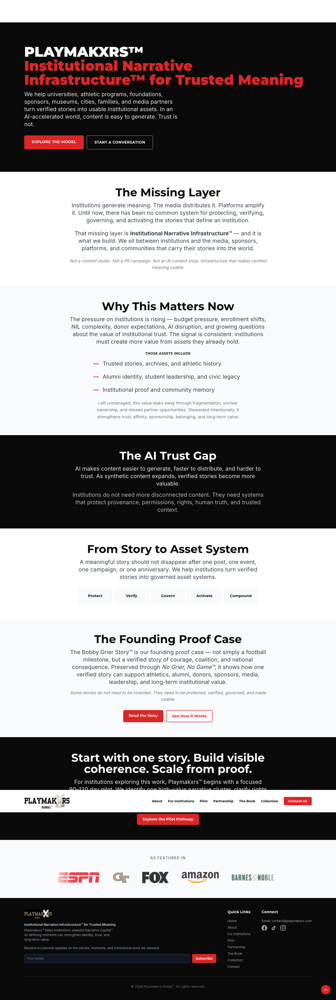
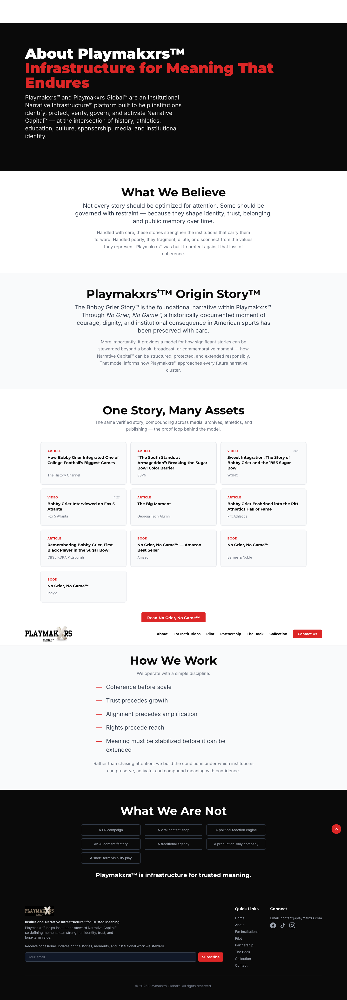
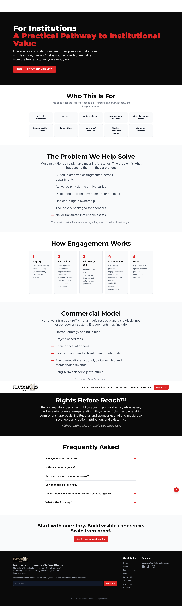
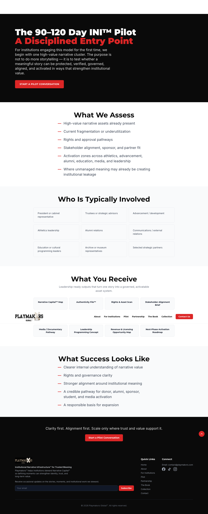
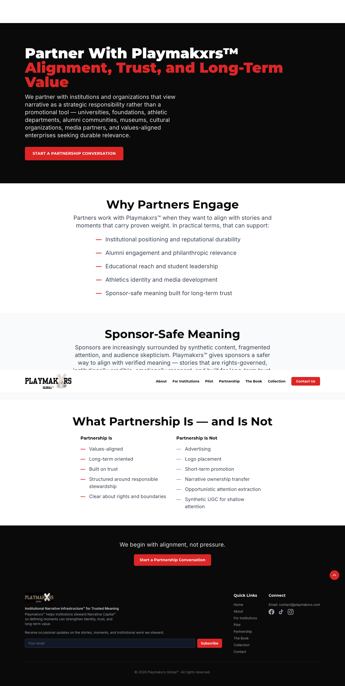
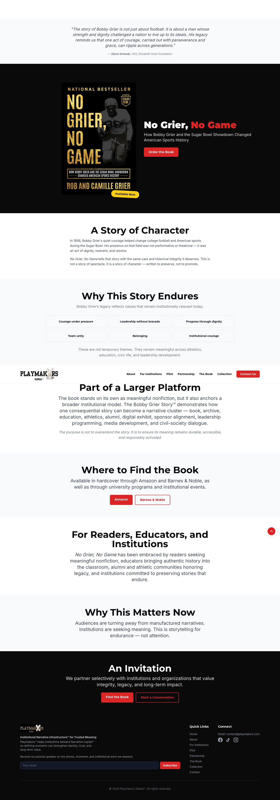
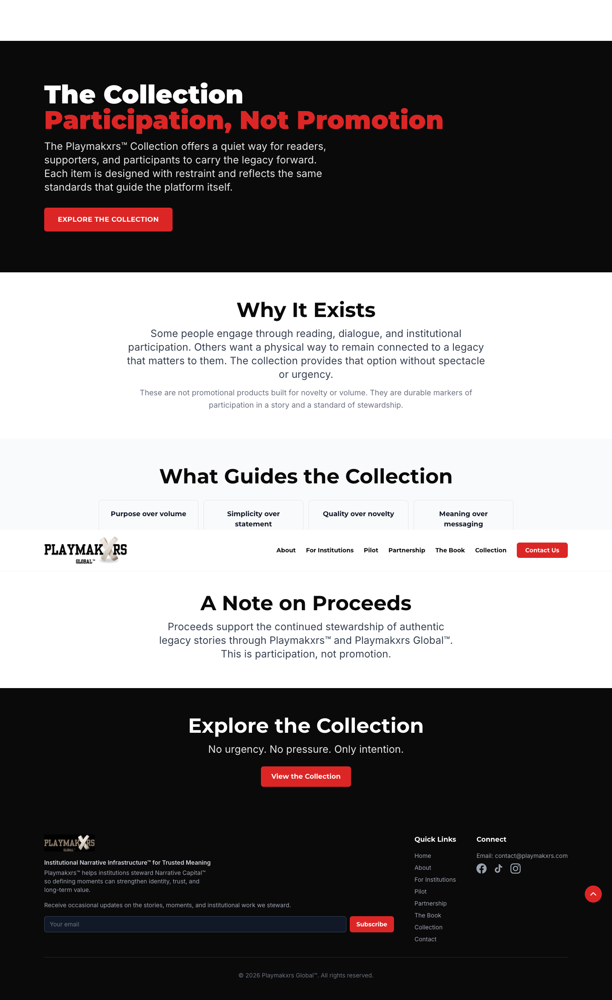
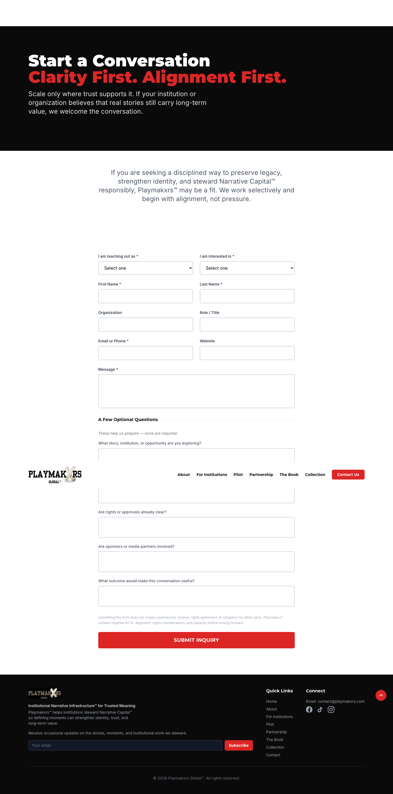

# Playmakxrs Website Overview (Temporary)

*This is a temporary section containing an overview of the current https://playmakxrs-preview-production.up.railway.app website prior to rebuilding.* 

## Old Site Structure & Controls

### Global Design & Aesthetics
- **Theme:** High contrast, alternating between dark mode (black) for heroes/CTAs and light mode (white/light gray) for content.
- **Typography:** Clean, modern sans-serif with bold headers.
- **Color Palette:** True Black, Pure White, Light Gray, and Accent Red (used for text highlights, primary buttons, and custom bullet dashes `—`).
- **Controls:** Solid red buttons with white text for primary actions, transparent borders for secondary actions. Outlined cards and boxes used for grouping grid content.

### Global Components
- **Header:** Sticky navbar with inline links and a solid red "Contact Us" CTA.
- **Footer:** Three columns (Brand/Subscribe form, Quick Links, Connect) and a red floating "Back to Top" button.

### Key Page Highlights
- **Home:** Alternates text-heavy sections with custom lists, horizontal outlined pills, and a social-proof logo section.
- **About Us & Pilot:** Heavy use of 3x2 and 4x2 outlined card grids to present deliverables, roles, and media assets.
- **For Institutions:** Features a 5-step vertical process component and accordion-style FAQs.
- **Contact Us:** Uses a very comprehensive intake form with dropdowns, standard inputs, and multiple large textareas to capture deep institutional context.

## https://playmakxrs-preview-production.up.railway.app

## https://playmakxrs-preview-production.up.railway.app/

## https://playmakxrs-preview-production.up.railway.app/about-us

## https://playmakxrs-preview-production.up.railway.app/for-institutions

## https://playmakxrs-preview-production.up.railway.app/pilot

## https://playmakxrs-preview-production.up.railway.app/partnership

## https://playmakxrs-preview-production.up.railway.app/the-book

## https://playmakxrs-preview-production.up.railway.app/collection

## https://playmakxrs-preview-production.up.railway.app/contact-us

# Playmakxrs: Comprehensive Technical Specifications

This document serves as the master blueprint for building the new Playmakxrs website based on the approved premium sports-centric mockups. 

## 1. Technology Stack
- **Framework:** Next.js (App Router)
- **Library:** React
- **Styling:** Tailwind CSS (for all layouts, grids, and utility classes)
- **Animations:** GSAP (GreenSock) for high-performance scroll animations, parallax effects, and staggered reveals.
- **Carousels:** `embla-carousel-react` for smooth, touch-friendly sliders (used for testimonials, media galleries, or mobile layout adaptations).

## 2. Global Design System (Tailwind Configuration)

### Color Palette
Update your `tailwind.config.js` to include these core brand colors:
- **Backgrounds:**
  - `bg-true-black`: `#000000` (Used for Hero sections and deep contrast).
  - `bg-deep-navy`: `#0A1128` (Used for secondary dark sections).
  - `bg-light-gray`: `#F9F9F9` (Used for contrasting light sections).
  - `bg-card-dark`: `#141C3A` (Used for card backgrounds on dark modes).
- **Accents:**
  - `text-crimson` / `bg-crimson`: `#E53935` (Primary call-to-actions, active states, data-viz).
  - `text-gold`: `#D4AF37` (Subtle accent specifically for the 'Families' legacy page).
- **Text:**
  - `text-pure-white`: `#FFFFFF`
  - `text-charcoal`: `#1E1E1E` (For text on light backgrounds).
  - `text-gray-400`: `#9CA3AF` (For secondary descriptive text on dark backgrounds).

### Typography
- **Headings (Display):** A bold, condensed sans-serif (e.g., `font-oswald` or `font-teko`). Must be used in uppercase for high impact.
- **Headings (Elegant):** A refined serif (e.g., `font-playfair`) used sparingly on the Families and About pages for a legacy feel.
- **Body:** Clean sans-serif (e.g., `font-inter`).

### GSAP Animation Guidelines
- **Hero Reveal:** `gsap.from()` on load. Fade in the background image with a subtle scale down (`scale: 1.05` to `1`), stagger the appearance of the H1, subhead, and CTA button.
- **Scroll Triggers:** As sections enter the viewport, fade them in and translate them slightly on the Y-axis (`y: 30`, `opacity: 0`). 
- **Staggered Grids:** For card grids (like the logos or media assets), use GSAP staggers so cards pop in sequentially (`stagger: 0.1`).

---

## 3. Page-by-Page Blueprints

### A. Home Page (`/`)
- **Hero (`bg-true-black`):** Full viewport height. Background image is a black-and-white historic sports moment with a dark gradient overlay. Headline: "THE ERA OF LEGENDS". Button: `bg-crimson` "EXPLORE THE GLORY".
- **Hub Navigation:** Three primary cards or sections immediately below the hero routing to the three lanes (Institutions, Families, Sponsors). Use GSAP hover effects (scale up 1.02) on these cards.

### B. For Institutions (`/institutions`)
- **Hero:** Stadium image. "THE DEFINITIVE PLATFORM FOR UNIVERSITY ATHLETICS."
- **Solutions Grid:** 2x2 or 3x2 grid of cards (`bg-card-dark` with subtle `backdrop-blur` glassmorphism). Images of athletes in action on top, text below.
- **Client Spotlight:** A horizontal row of university logos. 

### C. Families & Athletes (`/families`)
- **Hero:** Intimate archival photo (e.g., grandfather and child). "WHERE LEGACY LIVES FOREVER". Serif typography for the heading.
- **Services Grid:** 3 columns. Cards feature outlined gold borders (`border-gold`). Topics: "Book Publishing", "Merchandise", "Rights Protection". Images inside cards should look like physical objects (books, letterman jackets, historic documents).

### D. Sponsors & Media (`/partners`)
- **Hero:** "CONNECT WITH THE WORLD'S LEADING SPORTS ECOSYSTEM." Includes data-viz cards floating on the right ("350M+ AUDIENCE REACH").
- **Network Grid:** 4x2 grid of partner logos on `bg-card-dark`.
- **Data Section:** 3 horizontal cards showing visual charts (line graphs, bar charts) in crimson red against navy backgrounds.
- **Media Cards:** 4-column grid showing broadcast/media capabilities.

### E. About / Case Study (`/about`)
- **Hero:** Large, dramatic black-and-white photo of Bobby Grier. "THE BOBBY GRIER STORY".
- **Editorial Content:** Single column, narrow width (`max-w-3xl`) for optimal reading. Drop caps for the first letter of paragraphs. High contrast white text on true black.
- **Associated Media Grid:** 4-column outlined card grid showcasing assets derived from the story (The Book, The Documentary, Podcast, Photos).

### F. Contact / Pilot Program (`/contact`)
- **Layout:** Two-column split.
  - **Left Column:** "PROGRAM BENEFITS" list. Use custom SVG icons (crimson checkmarks). Text explaining early access, roadmap shaping, dedicated support.
  - **Right Column (Form):** Encased in a `bg-card-dark` box with subtle border.
- **Form UI:** 
  - Sections: 1. Applicant Info, 2. Organization Details, 3. Contact Info.
  - Inputs: Dark inputs (`bg-black/50`) with white text and crimson focus rings (`focus:ring-crimson`).
  - Dropdowns: Use custom styled dropdowns (can use standard select or headless UI) to match the dark aesthetic.
  - Submit: Full-width `bg-crimson` button at the bottom.

---

## 4. Reusable Components to Build First
Before building the pages, create these core React components:
1. `<Button variant="primary|secondary|outline" />`
2. `<Card variant="glass|solid|outlined" />`
3. `<SectionHeading title="" subtitle="" />`
4. `<EmblaCarousel slides={[]} />` (For mobile views where grids collapse into swipeable lists).
